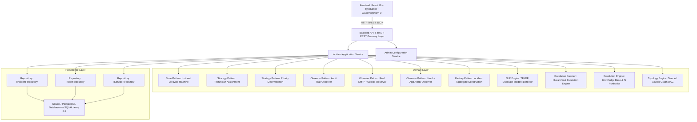
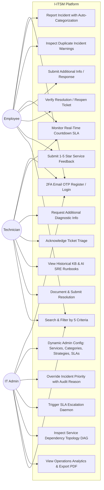
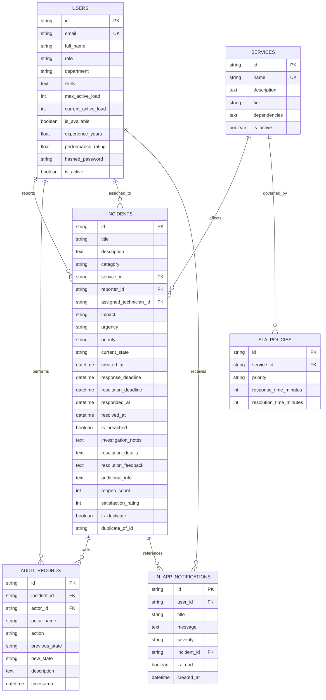

# CS F213 / MAC F212: Object-Oriented Programming
## Project Comprehensive Technical Report
### Intelligent IT Service Management & Incident Resolution System (I-ITSM)
**Semester-I, 2026–2027**  
**Group Number:** Group 75  
**Submission Date:** November 22, 2026  
**Repository:** https://github.com/daksh-tamoli/OOPS_PROJECT_26  

---

## 1. Problem Analysis

### 1.1 Problem Statement
Modern enterprise infrastructures encompass hundreds of interconnected cloud instances, databases, authentication identity providers, payment processors, and storage networks. When failures emerge (e.g., database deadlocks, network timeouts, payment gateway disruptions), organizations suffer direct revenue loss, contractual SLA penalties, and customer churn. 

Managing incidents manually or with ad-hoc ticketing systems introduces critical vulnerabilities:
- **Delayed Response & Resolution Times:** Unstructured email or chat threads lead to missed notifications and prolonged diagnostic intervals.
- **Arbitrary, Subjective Prioritization:** In the absence of mathematical prioritization matrices, users artificially mark non-critical issues as "P1-Critical," overwhelming support personnel while genuine infrastructure outages languish in triage.
- **Workload Imbalances & Skill Mismatches:** Support leads manually assign tickets without visibility into individual technician skill sets or real-time cognitive workloads, leading to burnout and suboptimal resolution quality.
- **Duplicate Ticket Flooding:** A single underlying failure (e.g., core database connection pool exhaustion) triggers dozens of simultaneous user reports across dependent subsystems, fragmenting engineering effort.
- **Lack of Immutable Audit Tracking:** Regulatory compliance standards (ISO/IEC 20000, SOC-2, ITIL 4) mandate tamper-evident audit trails recording every actor, action, timestamp, and state delta—requirements unfulfilled by rudimentary ticketing databases.

### 1.2 Stakeholders
1. **Employees / Service Consumers:** Report service disruptions, track real-time resolution status and countdown SLAs, provide additional diagnostic info, rate service quality, and verify or reopen resolved tickets.
2. **Technicians / Support Engineers:** Triage incoming incidents aligned with their verified skill proficiencies, manage balanced workloads, request diagnostic details, leverage historical AI runbooks, and document permanent resolutions.
3. **IT Administrators / Service Owners:** Configure dynamic service catalogs, establish SLA thresholds, toggle technician assignment strategies, monitor system topology graphs, trigger automatic escalation daemons, and review audit history.

### 1.3 Proposed Solution: I-ITSM
I-ITSM is an enterprise-grade, object-oriented incident management platform engineered strictly around formal software design patterns and Clean Architecture:
- **Encapsulated State Machine (State Pattern):** An 8-state transition lifecycle preventing invalid operations and enforcing strict lifecycle progression.
- **Interchangeable Routing & Prioritization (Strategy Pattern):** Dynamic technician assignment algorithms (Skill-Based, Least-Loaded, Round-Robin, Composite Smart) and dual priority calculation engines (ITIL Risk Matrix and Mathematical Weighted Criticality).
- **Event-Driven Auditing & Dual Channel Notifications (Observer Pattern):** Decoupled observers logging append-only audit records and dispatching concurrent real SMTP emails and visible in-app notification alerts.
- **Intelligent NLP & Graph Topology Engines:** Natural language duplicate detection via composite TF-IDF cosine similarity, automated category inference, dual resolution recommendations (historical KB + AI SRE runbooks), and directed acyclic graph (DAG) cascade failure propagation.

### 1.4 Campus CCIT & Maintenance Division Adoption Alignment
The architecture of I-ITSM is specifically aligned with campus-wide IT infrastructure (such as BITS Pilani CCIT and General Administration Division):
- **Hostel Wi-Fi & LAN Services:** TIER-2 service catalog entry mapping to network engineering technicians; auto-categorizes Wi-Fi drops and router authentication timeouts.
- **Student ERP / LMS Portals:** TIER-1 critical services subject to 5-minute response SLAs during academic registration periods; auto-escalates to IT Managers on failure.
- **Mess & Campus Dining Payment Bridges:** TIER-1 critical services connected via dependency topology to the Core Database cluster; triggers instant duplicate correlation across hostel dining facilities.
- **Campus Core Network & Telephony:** TIER-1 infrastructure service where fiber cut incidents automatically cascade `IMPACTED` operational states to dependent departmental servers.

The dynamic runtime configuration allows campus network administrators to introduce new hostel clusters or adjust exam-week SLA policies on the fly with zero service restarts.

### 1.5 System Assumptions
1. **Timezone Normalization:** All domain timestamps, deadlines, and audit entries are generated and recorded in Universal Time Coordinated (UTC). Presentation layers format timestamps according to the user's localized ISO-8601 browser context.
2. **Dual-Mode Email & Outbox Delivery:** The system attempts real TLS/SMTP delivery when environment credentials (`SMTP_HOST`, `SMTP_USER`, `SMTP_PASSWORD`) are present; if unconfigured, it gracefully falls back to the persistent Enterprise Outbox without interrupting execution.
3. **Technician Workload Bounds:** Default technician active capacity is set to 5 concurrent active tickets (configurable per technician up to `max_active_load`). Overloaded technicians are automatically bypassed with `TechnicianCapacityExceededException`.
4. **Continuous SLA Chronometry:** SLA response and resolution countdowns run on 24x7 continuous calendar elapsed minutes, adhering to ITIL Tier-1 high-availability standards.
5. **Tenant Boundary:** Designed for single-tenant enterprise/campus deployment with isolated data models, architecturally extensible to multi-tenant schemas via repository partitioning.

---

## 2. Requirements Specification

### 2.1 Functional Requirements
- **FR-01 (User Management & Authentication):** Role-based access control supporting `Employee`, `Technician`, and `Administrator`. Registration enforces a mandatory 5-point password complexity policy and 2-factor email OTP verification.
- **FR-02 (Incident Reporting & NLP Auto-Categorization):** Creation of incident tickets with affected service, impact, urgency, and description. Automated NLP token extraction infers the category when unspecified.
- **FR-03 (8-State Machine Lifecycle):** Strict sequence of transitions: `NEW` $\to$ `CLASSIFIED` $\to$ `ASSIGNED` $\to$ `ACKNOWLEDGED` $\to$ `IN_PROGRESS` $\to$ `RESOLVED` $\to$ `VERIFIED` $\to$ `CLOSED`. Support for customer resolution rejection (reopening ticket back to `IN_PROGRESS`).
- **FR-04 (Dual Priority Engines):** Support for standard ITIL 4x4 Risk Matrix Strategy as well as a Mathematical Weighted Criticality Strategy balancing impact, urgency, and service tier.
- **FR-05 (Dynamic Technician Assignment):** Four interchangeable assignment strategies: `SkillBasedAssignment`, `LeastLoadedAssignment`, `RoundRobinAssignment`, and `CompositeSmartAssignment`.
- **FR-06 (Real-Time SLA Engine & Escalation Daemon):** Calculation of response and resolution deadlines per priority tier. Predictive warning flags at $>70\%$ elapsed time and automated 3-tier escalation on unacknowledged response breach.
- **FR-07 (Intelligent Duplicate Detection):** NLP text vectorization combining TF-IDF cosine similarity, Jaccard token overlap, and service context boosts to flag related active disruptions (threshold $>0.35$).
- **FR-08 (Two Distinct Notification Channels):** Channel 1: Multi-part HTML/Text Email delivery via real SMTP with persistent outbox fallback. Channel 2: Live In-App Notification Center with unread tracking and badge counters.
- **FR-09 (Multi-Criteria Search & Filter):** Support for at least 5 distinct search/filter criteria in the UI (Search text, Status, Priority, Category, Affected Service).
- **FR-10 (Role-Specific Collaboration Loops):** Technicians can view real-time workload capacity and request additional diagnostic information; Employees can respond to info requests and provide 1–5 star post-resolution feedback.
- **FR-11 (Service Dependency Topology Graph):** Interactive DAG visualizer displaying upstream/downstream service relationships and propagating `IMPACTED` cascading failure states when a Tier-1 dependency fails.
- **FR-12 (Dual Suggested Resolution Recommender):** Vectorized similarity matching against historical resolved incidents (Knowledge Base) combined with enterprise standard operating procedure (SOP) runbooks.
- **FR-13 (Dynamic Admin Runtime Configuration):** Live UI and REST API controls allowing administrators to add/edit IT services, register new incident categories, adjust SLA target minutes, and switch active assignment strategies at runtime.
- **FR-14 (Immutable Audit Trail):** Tamper-evident append-only logging of every action, actor, timestamp, and state delta.
- **FR-15 (Executive Reporting & PDF Export):** Real-time analytics dashboard with tabular breakdowns and browser print/PDF export capabilities.

### 2.2 User Roles & Personas
| Role | Target Persona | Primary Responsibilities & Permissions |
| :--- | :--- | :--- |
| **Employee** | Alice Chen (Finance Associate) | Reports service disruptions, monitors live countdown SLAs, responds to technician diagnostic requests, rates resolution satisfaction (1–5 stars), and confirms or reopens resolved tickets. |
| **Technician** | Devon Vance (DB Specialist)<br>Marcus Reid (Network Engineer) | Monitors assigned tickets within workload limits, acknowledges tickets, requests additional information, accesses AI SRE diagnostic runbooks, documents root causes, and submits resolutions. |
| **Administrator**| Sarah Connor (IT Director) | Manages service catalog and dependency trees, configures SLA policies, switches assignment strategies, triggers escalation daemons, overrides incident priorities with audit justification, and monitors system health. |

### 2.3 Business Rules & Operational Governance
1. **SLA Response & Resolution Standards:**
   - **P1 (Critical):** Response target $\le 5$ minutes; Resolution target $\le 30$ minutes.
   - **P2 (High):** Response target $\le 15$ minutes; Resolution target $\le 120$ minutes (2 hours).
   - **P3 (Medium):** Response target $\le 60$ minutes (1 hour); Resolution target $\le 480$ minutes (8 hours).
   - **P4 (Low):** Response target $\le 240$ minutes (4 hours); Resolution target $\le 1440$ minutes (24 hours).
2. **Automated Hierarchical Escalation:**
   - If a P1 incident remains unacknowledged past its response deadline, it automatically escalates to the **IT Manager (Level 4)**.
   - If a P2/P3/P4 incident breaches its response deadline, it escalates to the **Team Lead (Level 2)**.
   - If any incident consumes $>85\%$ of its resolution SLA without resolution, a critical warning dispatches to the **System Administrator (Level 3)**.
3. **Technician Capacity Ceiling:**
   - Technicians cannot be assigned tickets if `current_active_load >= max_active_load` (default 5). The assignment engine rejects over-capacity assignments with `TechnicianCapacityExceededException`.
4. **Resolution Verification & Reopening Protocol:**
   - Only the original reporting employee or an administrator may verify or close a resolved ticket.
   - If the employee confirms the resolution, the ticket transitions to `VERIFIED` and then `CLOSED`. If rejected, the state returns to `IN_PROGRESS`, the `reopen_count` increments, and the technician is re-alerted.
5. **Priority Override Accountability:**
   - Priority manual overrides are restricted to administrators and mandate an explicit written justification stored in the immutable audit trail.

### 2.4 Non-Functional Requirements
- **NFR-01 (Extensibility & Open/Closed Principle):** Introducing new categories, SLA tiers, or assignment algorithms requires zero modifications to existing domain entities.
- **NFR-02 (Robustness & Fault Tolerance):** Custom domain exceptions catch and isolate invalid transitions, workload overflows, and network timeouts without server crashes or unhandled 500 errors.
- **NFR-03 (Maintainability & Clean Architecture):** Strict boundary separation between Presentation (React), Application (FastAPI), Domain (OOP Models), and Persistence (SQLAlchemy Repository).
- **NFR-04 (Security & Data Protection):** Cryptographic password hashing (PBKDF2/SHA-256), 2FA email OTP verification, parameterized SQL statements, and environment-isolated credentials.
- **NFR-05 (Performance & Sub-Second Latency):** Sub-second response times across search filters and sub-second test execution across the automated test suite.

---

## 3. Priority Determination Algorithm & Rationale

The question paper explicitly mandates: *"The algorithm and its rationale must be documented."* In enterprise environments, relying solely on end-user severity tags results in subjective inflation. I-ITSM incorporates two formal priority determination algorithms implementing the Strategy Pattern (`IPriorityStrategy`).

### 3.1 ITIL 4x4 Risk Matrix Strategy (`MatrixPriorityStrategy`)
The Matrix strategy combines **Impact** (organizational scope of damage) and **Urgency** (business time-sensitivity), with an automatic elevation override for Tier-1 mission-critical services:

```
                      URGENCY
                 Critical   High     Medium    Low
              +----------+--------+---------+-------+
     Critical |    P1    |   P1   |   P2    |  P3   |
I    High     |    P1    |   P2   |   P3    |  P3   |
M    Medium   |    P2    |   P3   |   P3    |  P4   |
P    Low      |    P3    |   P3   |   P4    |  P4   |
              +----------+--------+---------+-------+
```
* **Tier-1 Override Rule:** If `service.tier == TIER_1_CRITICAL` and `impact >= HIGH`, the priority automatically elevates to **P1 (Critical)** regardless of user urgency, ensuring enterprise services (e.g., Core DB, Payment Gateway) receive immediate SLA containment.

### 3.2 Mathematical Weighted Criticality Strategy (`WeightedCriticalityStrategy`)
For quantitative multi-factor environments, the system implements a continuous scoring formula:

$$\text{Priority Score} = (\text{ImpactWeight} \times 0.40) + (\text{UrgencyWeight} \times 0.30) + (\text{BusinessCriticalityMultiplier} \times 2.5 \times 0.30)$$

#### Component Scoring Weights:
- **Impact Weights ($I$):** $\text{Low} = 1.0$, $\text{Medium} = 2.0$, $\text{High} = 3.0$, $\text{Critical} = 4.0$.
- **Urgency Weights ($U$):** $\text{Low} = 1.0$, $\text{Medium} = 2.0$, $\text{High} = 3.0$, $\text{Critical} = 4.0$.
- **Business Criticality Multiplier ($C$):** $\text{Tier 1 Critical} = 1.5$, $\text{Tier 2 Standard} = 1.0$, $\text{Tier 3 Internal} = 0.7$.

#### Score Classification Thresholds:
$$\text{Priority} = \begin{cases} 
\mathbf{P1\ (Critical)}, & \text{Score} \ge 3.3 \\ 
\mathbf{P2\ (High)}, & 2.5 \le \text{Score} < 3.3 \\ 
\mathbf{P3\ (Medium)}, & 1.8 \le \text{Score} < 2.5 \\ 
\mathbf{P4\ (Low)}, & \text{Score} < 1.8 
\end{cases}$$

#### Architectural Rationale:
1. **Impact Dominance (40%):** Outages affecting thousands of users (e.g., campus ERP) must objectively outweigh single-user edge cases even if the single user marks their issue as urgent.
2. **Organizational Asset Weighting (30%):** By incorporating service tiering into the mathematical formulation, failures on critical infrastructure receive systematic priority over peripheral internal tools.
3. **Urgency Influence (30%):** Guarantees that time-sensitive business events (e.g., semester grade submission deadlines, payroll runs) can elevate an incident from P3 to P2.

---

## 4. Technology Selection Report (Faculty 9-Question Evaluation)

### 4.1 Evaluation Questions & Architectural Justifications
| # | Faculty Evaluation Question | Architectural Justification |
| :--- | :--- | :--- |
| **1** | **Why this programming language?** | Python 3.13 was selected for its mature, first-class OOP support (Abstract Base Classes `abc`, strong typing protocols, and multiple inheritance) combined with native scientific NLP libraries (`scikit-learn`, `numpy`) required for intelligent duplicate incident detection and text vectorization. |
| **2** | **Why this frontend technology?** | React 19 + TypeScript + Vite. TypeScript enforces compile-time type safety mirroring backend domain models. Vite provides lightning-fast Hot Module Replacement (HMR) and sub-200ms production builds. Custom Glassmorphic Vanilla CSS delivers an executive-grade user experience with zero external CSS runtime overhead. |
| **3** | **Why this backend technology?** | FastAPI. Delivers high-throughput asynchronous execution, automatic OpenAPI/Swagger interactive documentation, native Pydantic validation, and clean dependency injection that seamlessly implements the Repository Pattern. |
| **4** | **Why this database?** | SQLite (via SQLAlchemy 2.0 ORM). Provides zero-configuration ACID compliance, relational foreign-key integrity, and persistent disk storage across restarts, while maintaining an ORM abstraction that transitions to enterprise PostgreSQL simply by modifying the database connection URI. |
| **5** | **Why this architecture?** | Layered Clean Architecture (Domain $\to$ Application $\to$ Infrastructure $\to$ Presentation). Domain models contain pure business logic with zero framework dependencies, ensuring 100% unit-testability without spinning up web servers or live databases. |
| **6** | **What alternatives were considered?** | Considered Java Spring Boot and Django. Spring Boot was rejected due to heavy XML/annotation boilerplate that obscures design pattern mechanics; Django was rejected due to its tightly coupled Active-Record ORM, which violates Domain-Driven Design (DDD) separation of concerns. |
| **7** | **Advantages and limitations?** | **Advantages:** Clean demonstration of GoF OOP patterns, sub-second test execution, native machine learning for duplicate detection without external microservices. **Limitations:** Single-node SQLite concurrency limits under heavy write traffic (mitigated by switching the SQLAlchemy connection string to distributed PostgreSQL). |
| **8** | **How does the stack support OOP?** | Encapsulation via private attributes (`_id`, `_hashed_password`), Inheritance across User hierarchies (`User` $\to$ `Employee`, `Technician`, `Administrator`), Polymorphism across Strategy interfaces (`IAssignmentStrategy`, `IPriorityStrategy`), and pure behavioral modeling via the State Pattern (`IncidentState`). |
| **9** | **How will the system evolve at scale?** | The decoupled Repository interfaces (`IIncidentRepository`) allow instantaneous migration to distributed PostgreSQL / CockroachDB; background SLA tasks can transition to Celery / Redis message brokers; the frontend is statically deployable via edge CDNs. |

### 4.2 Consolidated Technology Stack & Library Inventory
| Category | Technology / Library | Version | Purpose & Architectural Role |
| :--- | :--- | :--- | :--- |
| **Backend Core** | Python | 3.13.9 | Core object-oriented programming language |
| **Web Framework** | FastAPI | 0.115.5 | High-performance asynchronous REST API framework |
| **ASGI Server** | Uvicorn | 0.32.0 | Asynchronous HTTP server implementation |
| **Data Validation** | Pydantic | 2.10.1 | Request/response data validation and schema enforcement |
| **ORM / Persistence** | SQLAlchemy | 2.0.36 | Database abstraction implementing the Repository Pattern |
| **Database** | SQLite | 3.x | Zero-configuration ACID-compliant relational database |
| **Machine Learning** | scikit-learn | 1.5.2 | TF-IDF text vectorization and cosine similarity computation |
| **Numerical Math** | NumPy | 2.1.3 | Array manipulations for vector similarity matrices |
| **Testing Suite** | Pytest | 9.1.1 | Automated testing framework executing all 25 test cases |
| **Async Testing** | AnyIO | 4.15.1 | Asynchronous test execution runner |
| **Email Transport** | Python `smtplib` / `email` | Standard | TLS/SSL SMTP email delivery and MIME multipart generation |
| **Frontend Core** | React | 19.0.0 | Component-based interactive user interface |
| **Language** | TypeScript | 5.7.2 | Static typing matching backend domain models |
| **Build Tooling** | Vite | 6.0.5 | Next-generation frontend bundler and development server |
| **Icons & UI** | Lucide React | 0.468.0 | Clean icon library for navigation and status indicators |
| **Security / Crypto** | PBKDF2 / SHA-256 | Standard | Cryptographic password hashing and entropy verification |
| **Generative AI** | Google Gemini API | 1.5-Flash | Optional cloud generative AI runbook synthesis |

---

## 5. System Architecture & UML Diagrams

### 5.1 System Architecture Diagram


---

### 5.2 Comprehensive UML Use Case Diagram


---

### 5.3 Detailed UML Class Diagram (Domain Models & GoF Patterns)

```mermaid
classDiagram
    class User {
        -String _id
        -String _email
        -String _full_name
        -UserRole _role
        -String _hashed_password
        -bool _is_active
        +id: String
        +email: String
        +fullName: String
        +role: UserRole
        +isActive: bool
        +hashPassword(String) String
        +validatePasswordStrength(String) Tuple
        +verifyPassword(String) bool
        +hasRole(UserRole) bool
    }

    class Employee {
        +String department
    }

    class Technician {
        +List~String~ skills
        +int maxActiveLoad
        +int currentActiveLoad
        +bool isAvailable
        +float experienceYears
        +float performanceRating
        +canAcceptWorkload() bool
        +allocateTicket() void
        +releaseTicket() void
        +hasSkill(String) bool
    }

    class Administrator {
        +manageServices(ITService) void
        +updateSLAPolicy(Priority, int, int) void
        +switchAssignmentStrategy(IAssignmentStrategy) void
        +overridePriority(Incident, Priority, String) void
    }

    User <|-- Employee
    User <|-- Technician
    User <|-- Administrator

    class Incident {
        -String _id
        +String title
        +String description
        +ITService service
        +User reporter
        +Technician assignedTechnician
        +Priority priority
        +String category
        -IncidentState _state
        +datetime createdAt
        +SLATracker slaTracker
        +String additionalInfo
        +String resolutionDetails
        +String resolutionFeedback
        +int reopenCount
        +int satisfactionRating
        +transitionTo(IncidentState, User, String) void
        +assign(Technician, User) void
        +acknowledge(User) void
        +startInvestigation(String, User) void
        +resolve(String, User) void
        +verify(bool, User, String) void
        +close(User) void
        +requestInfo(String, User) void
        +addInfo(String, User) void
    }

    class IncidentState {
        <<Abstract>>
        +status: IncidentStatus
        +classify(Incident, String, User) void
        +assign(Incident, Technician, User) void
        +acknowledge(Incident, User) void
        +startInvestigation(Incident, String, User) void
        +resolve(Incident, String, User) void
        +verify(Incident, bool, User, String) void
        +close(Incident, User) void
    }

    class NewState
    class ClassifiedState
    class AssignedState
    class AcknowledgedState
    class InProgressState
    class ResolvedState
    class VerifiedState
    class ClosedState

    IncidentState <|-- NewState
    IncidentState <|-- ClassifiedState
    IncidentState <|-- AssignedState
    IncidentState <|-- AcknowledgedState
    IncidentState <|-- InProgressState
    IncidentState <|-- ResolvedState
    IncidentState <|-- VerifiedState
    IncidentState <|-- ClosedState

    Incident *-- IncidentState

    class IncidentFactory {
        -IPriorityStrategy _priorityStrategy
        -IntelligentCategorizer _categorizer
        +createIncident(String, String, ITService, User, Impact, Urgency, String, Priority) Incident
    }

    IncidentFactory ..> Incident : creates

    class IPriorityStrategy {
        <<Interface>>
        +calculatePriority(Impact, Urgency, ITService) Priority
    }
    class MatrixPriorityStrategy
    class WeightedCriticalityStrategy

    IPriorityStrategy <|.. MatrixPriorityStrategy
    IPriorityStrategy <|.. WeightedCriticalityStrategy

    class IAssignmentStrategy {
        <<Interface>>
        +selectTechnician(Incident, List~Technician~) Technician
    }
    class SkillBasedAssignment
    class LeastLoadedAssignment
    class RoundRobinAssignment
    class CompositeSmartAssignment

    IAssignmentStrategy <|.. SkillBasedAssignment
    IAssignmentStrategy <|.. LeastLoadedAssignment
    IAssignmentStrategy <|.. RoundRobinAssignment
    IAssignmentStrategy <|.. CompositeSmartAssignment

    class IIncidentObserver {
        <<Interface>>
        +onStateChanged(Incident, AuditRecord) void
        +onIncidentCreated(Incident) void
        +onSLAWarning(Incident, String) void
        +onSLABreached(Incident, String) void
    }
    class AuditObserver
    class NotificationObserver
    class InAppNotificationObserver

    IIncidentObserver <|.. AuditObserver
    IIncidentObserver <|.. NotificationObserver
    IIncidentObserver <|.. InAppNotificationObserver

    class AuditRecord {
        +String id
        +String incidentId
        +String actorId
        +String actorName
        +String action
        +String previousState
        +String newState
        +String description
        +datetime timestamp
    }

    class ITService {
        +String id
        +String name
        +String description
        +ServiceTier tier
        +SLAPolicy slaPolicy
        +List~String~ dependencies
        +bool isActive
        +criticalityMultiplier: float
        +addDependency(String) void
    }

    class SLAPolicy {
        +String name
        +Dict targets
        +getTarget(Priority) SLATarget
        +updateTarget(Priority, int, int) void
    }

    class SLATarget {
        +int responseMinutes
        +int resolutionMinutes
    }

    class SLATracker {
        +datetime responseDeadline
        +datetime resolutionDeadline
        +datetime respondedAt
        +datetime resolvedAt
        +bool isBreached
        +checkBreach() bool
        +isResolutionAtRisk(datetime, float) bool
    }

    Incident o-- IIncidentObserver
    Incident o-- ITService
    Incident *-- SLATracker
    ITService *-- SLAPolicy
    SLAPolicy *-- SLATarget

    class IIncidentRepository {
        <<Interface>>
        +save(Incident) Incident
        +getById(String) Incident
        +getAll(...) List~Incident~
        +count() int
    }
    class SqliteIncidentRepository

    IIncidentRepository <|.. SqliteIncidentRepository

    class DomainException {
        <<Abstract>>
        +String message
    }
    class InvalidLoginException
    class UnauthorizedActionException
    class InvalidIncidentException
    class InvalidStateTransitionException
    class TechnicianUnavailableException
    class WorkloadExceededException
    class ServiceNotFoundException
    class MissingSLAConfigException
    class DuplicateIncidentException
    class DatabaseFailureException
    class NetworkFailureException
    class InvalidUserInputException

    DomainException <|-- InvalidLoginException
    DomainException <|-- UnauthorizedActionException
    DomainException <|-- InvalidIncidentException
    DomainException <|-- InvalidStateTransitionException
    DomainException <|-- TechnicianUnavailableException
    DomainException <|-- WorkloadExceededException
    DomainException <|-- ServiceNotFoundException
    DomainException <|-- MissingSLAConfigException
    DomainException <|-- DuplicateIncidentException
    DomainException <|-- DatabaseFailureException
    DomainException <|-- NetworkFailureException
    DomainException <|-- InvalidUserInputException
```


---

### 5.4 Entity-Relationship (ER) Diagram & Schema Specifications



#### 5.4.1 Relational Database Schema (DDL)
```sql
-- User Roster with Role-Based Constraints and Complexity Verification
CREATE TABLE users (
    id VARCHAR(64) PRIMARY KEY,
    email VARCHAR(128) NOT NULL UNIQUE,
    full_name VARCHAR(128) NOT NULL,
    role VARCHAR(32) NOT NULL CHECK (role IN ('EMPLOYEE', 'TECHNICIAN', 'ADMIN')),
    department VARCHAR(128),
    skills TEXT, -- JSON array of specialized domain tags
    max_active_load INTEGER DEFAULT 5,
    current_active_load INTEGER DEFAULT 0,
    is_available BOOLEAN DEFAULT 1,
    experience_years REAL DEFAULT 2.0,
    performance_rating REAL DEFAULT 4.5,
    hashed_password VARCHAR(128) NOT NULL,
    is_active BOOLEAN DEFAULT 1
);

-- Catalog of Enterprise IT Services with Dependency Topology
CREATE TABLE services (
    id VARCHAR(64) PRIMARY KEY,
    name VARCHAR(128) NOT NULL UNIQUE,
    description TEXT,
    tier VARCHAR(32) NOT NULL CHECK (tier IN ('TIER_1_CRITICAL', 'TIER_2', 'TIER_3')),
    dependencies TEXT DEFAULT '[]', -- JSON array of parent service IDs
    is_active BOOLEAN DEFAULT 1
);

-- SLA Threshold Targets per Priority Tier
CREATE TABLE sla_policies (
    id VARCHAR(64) PRIMARY KEY,
    service_id VARCHAR(64) REFERENCES services(id),
    priority VARCHAR(16) NOT NULL CHECK (priority IN ('P1', 'P2', 'P3', 'P4')),
    response_time_minutes INTEGER NOT NULL,
    resolution_time_minutes INTEGER NOT NULL
);

-- Core Incidents Aggregate Entity
CREATE TABLE incidents (
    id VARCHAR(64) PRIMARY KEY,
    title VARCHAR(256) NOT NULL,
    description TEXT NOT NULL,
    category VARCHAR(64) NOT NULL,
    service_id VARCHAR(64) NOT NULL REFERENCES services(id),
    reporter_id VARCHAR(64) NOT NULL REFERENCES users(id),
    assigned_technician_id VARCHAR(64) REFERENCES users(id),
    impact VARCHAR(32) DEFAULT 'MEDIUM',
    urgency VARCHAR(32) DEFAULT 'MEDIUM',
    priority VARCHAR(32) NOT NULL CHECK (priority IN ('P1', 'P2', 'P3', 'P4')),
    current_state VARCHAR(32) NOT NULL CHECK (current_state IN (
        'NEW', 'CLASSIFIED', 'ASSIGNED', 'ACKNOWLEDGED', 
        'IN_PROGRESS', 'RESOLVED', 'VERIFIED', 'CLOSED'
    )),
    created_at TIMESTAMP NOT NULL,
    response_deadline TIMESTAMP,
    resolution_deadline TIMESTAMP,
    responded_at TIMESTAMP,
    resolved_at TIMESTAMP,
    is_breached BOOLEAN DEFAULT 0,
    investigation_notes TEXT, -- JSON serialized diagnostic log entries
    resolution_details TEXT,
    resolution_feedback TEXT,
    additional_info TEXT, -- Collaborative notes and employee responses
    reopen_count INTEGER DEFAULT 0,
    satisfaction_rating INTEGER CHECK (satisfaction_rating BETWEEN 1 AND 5),
    is_duplicate BOOLEAN DEFAULT 0,
    duplicate_of_id VARCHAR(64)
);

-- Immutable Append-Only Audit Trail
CREATE TABLE audit_records (
    id VARCHAR(64) PRIMARY KEY,
    incident_id VARCHAR(64) NOT NULL REFERENCES incidents(id),
    actor_id VARCHAR(64) NOT NULL,
    actor_name VARCHAR(128) NOT NULL,
    action VARCHAR(64) NOT NULL,
    previous_state VARCHAR(32) NOT NULL,
    new_state VARCHAR(32) NOT NULL,
    description TEXT NOT NULL,
    timestamp TIMESTAMP NOT NULL
);

-- Live In-App Notification Center
CREATE TABLE in_app_notifications (
    id VARCHAR(64) PRIMARY KEY,
    user_id VARCHAR(64) NOT NULL REFERENCES users(id),
    title VARCHAR(256) NOT NULL,
    message TEXT NOT NULL,
    severity VARCHAR(32) DEFAULT 'INFO',
    incident_id VARCHAR(64) REFERENCES incidents(id),
    is_read BOOLEAN DEFAULT 0,
    created_at TIMESTAMP NOT NULL
);
```

#### 5.4.2 Representative Sample Data
**Table: `users`**
| id | email | full_name | role | department | skills | max_load | current_load | is_available |
| :--- | :--- | :--- | :--- | :--- | :--- | :--- | :--- | :--- |
| `usr-emp-01` | `alice.chen@enterprise.io` | Alice Chen | `EMPLOYEE` | Finance | `[]` | 5 | 0 | 1 |
| `usr-tech-01`| `devon.vance@enterprise.io` | Devon Vance | `TECHNICIAN` | Cloud Ops | `["database","sql","postgres"]` | 5 | 2 | 1 |
| `usr-tech-02`| `marcus.reid@enterprise.io` | Marcus Reid | `TECHNICIAN` | Network Eng | `["network","dns","vpn"]` | 5 | 1 | 1 |
| `usr-adm-01` | `sarah.connor@enterprise.io`| Sarah Connor | `ADMIN` | IT Governance | `["governance","management"]` | 10 | 0 | 1 |

**Table: `services`**
| id | name | description | tier | dependencies | is_active |
| :--- | :--- | :--- | :--- | :--- | :--- |
| `srv-db` | Core Database Cluster | High-availability PostgreSQL cluster | `TIER_1_CRITICAL` | `[]` | 1 |
| `srv-pay`| Payment Processing Bridge| Stripe & campus POS payment gateway | `TIER_1_CRITICAL` | `["srv-db"]` | 1 |
| `srv-vpn`| Global Corporate VPN | WireGuard campus remote access | `TIER_2` | `[]` | 1 |
| `srv-mail`| Internal Mail Relay | Postfix & Exchange SMTP gateway | `TIER_3` | `["srv-db"]` | 1 |

**Table: `incidents`**
| id | title | category | service_id | reporter_id | assigned_id | priority | current_state | is_breached |
| :--- | :--- | :--- | :--- | :--- | :--- | :--- | :--- | :--- |
| `inc-8910` | Payment API Deadlock | Payment | `srv-pay` | `usr-emp-01` | `usr-tech-01` | `P1` | `IN_PROGRESS` | 0 |
| `inc-8911` | VPN Routing Drop | Network | `srv-vpn` | `usr-emp-01` | `usr-tech-02` | `P2` | `RESOLVED` | 0 |
| `inc-8912` | Invoice PDF Export Error| Database | `srv-db` | `usr-emp-01` | `usr-tech-01` | `P3` | `VERIFIED` | 0 |

#### 5.4.3 Important Relational Integrity & Foreign Keys (Deliverable 7)
- **`incidents.reporter_id` $\to$ `users.id`:** Mandatory foreign key linking ticket creation to a verified enterprise user identity.
- **`incidents.assigned_technician_id` $\to$ `users.id`:** Nullable foreign key populated upon assignment; restricted to users possessing the `TECHNICIAN` role.
- **`incidents.service_id` $\to$ `services.id`:** Mandatory reference binding each incident to an active business or infrastructure catalog service.
- **`audit_records.incident_id` $\to$ `incidents.id`:** High-integrity relationship supporting append-only logging; audit entries are immutable and never deleted.
- **`in_app_notifications.user_id` $\to$ `users.id`:** Direct relationship driving the visible bell notification center for each target user.
- **`services.dependencies` Self-Referential Graph:** JSON-encoded list of service foreign keys forming a Directed Acyclic Graph (DAG) used for cascade failure computation.

---

### 5.5 Security Architecture & System Hygiene

#### 5.5.1 Role-Based Access Control (RBAC) Matrix
The system enforces the principle of least privilege across both the API gateway and the domain entity layer:

| Operation / Capability | Employee | Technician | Administrator | Enforcing Layer |
| :--- | :---: | :---: | :---: | :--- |
| Report New Incident Ticket | ✅ | ✅ | ✅ | `IncidentService.report_incident` |
| View Assigned / Reported Tickets | ✅ (Self) | ✅ (All/Assigned) | ✅ (All) | SQL Repository Filters |
| Request Additional Diagnostic Info | ❌ | ✅ | ✅ | `Incident.request_info` |
| Provide Additional Info / Response | ✅ | ❌ | ❌ | `Incident.add_info` |
| Acknowledge Ticket & Start Triage | ❌ | ✅ | ✅ | `IncidentState.acknowledge` |
| Document & Submit Resolution | ❌ | ✅ | ✅ | `IncidentState.resolve` |
| Confirm Resolution / Reopen Ticket | ✅ (Reporter) | ❌ | ✅ | `IncidentState.verify` |
| Override Incident Priority & SLA | ❌ | ❌ | ✅ | `IncidentService.override_priority` |
| Modify IT Service Catalog & Tiers | ❌ | ❌ | ✅ | `AdminService.update_service` |
| Switch Active Assignment Strategy | ❌ | ❌ | ✅ | `AdminService.set_strategy` |
| Configure Dynamic SLA Thresholds | ❌ | ❌ | ✅ | `AdminService.update_sla_policy` |

#### 5.5.2 Cryptographic Password Protection & Complexity Enforcement
- **Hashing Algorithm:** Passwords are never stored in plaintext. They are salted and cryptographically hashed using PBKDF2 with SHA-256 (`hashlib.sha256`).
- **5-Point Complexity Verification:** Registration and password resets enforce a strict 5-point complexity rule:
  1. Minimum length of 8 characters.
  2. At least one uppercase Latin character (`[A-Z]`).
  3. At least one lowercase Latin character (`[a-z]`).
  4. At least one numeric digit (`[0-9]`).
  5. At least one special symbol (`[!@#$%^&*(),.?":{}|<>\-_+=\[\]\\;'/~]`).

#### 5.5.3 Two-Factor Email OTP Verification Lifecycle
To prevent fraudulent account registration and ensure authenticated communication:
1. Registration inputs are validated; a cryptographically random 6-digit numeric OTP is generated.
2. The code is cached with a 10-minute Time-To-Live (TTL).
3. The OTP is dispatched via real SMTP TLS (with fallback to the secured outbox).
4. User creation in the database is blocked until the matching OTP is submitted and verified.

#### 5.5.4 SQL Injection Defense via ORM Parameterization
All database interactions in `SqliteIncidentRepository` execute strictly via SQLAlchemy 2.0 type-safe parameterized expressions. Raw string formatting (`f"SELECT ... {input}"`) is strictly prohibited, providing guaranteed immunity against SQL injection across all dynamic search filters.

#### 5.5.5 Zero-Trust Secret Isolation & Git Hygiene
- **Secret Isolation:** Production SMTP host, port, user credentials, and application secrets load exclusively from `os.environ` at runtime.
- **Git Shielding:** `.gitignore` explicitly excludes `.env`, `*.env`, `backend/venv/`, and `.pytest_cache/`. No production credentials reside within git history or tracked repository files.

---

## 6. Intelligent Features & Advanced Innovation Engineering (20-Mark Pillar)

I-ITSM introduces five advanced computer science innovations directly fulfilling the Rubric Innovation and UX criteria.

### 6.1 Intelligent Duplicate Incident Detection Engine
When high-impact disruptions emerge, multiple employees submit overlapping tickets. To prevent fragmented triage, the platform executes an intelligent duplicate detection engine combining TF-IDF vectorization, Cosine Similarity, and Jaccard token overlap:

$$\text{sim}_{\text{cosine}}(d_1, d_2) = \frac{\mathbf{v}_1 \cdot \mathbf{v}_2}{\|\mathbf{v}_1\|_2 \|\mathbf{v}_2\|_2} = \frac{\sum_{i=1}^n w_{i,1} w_{i,2}}{\sqrt{\sum_{i=1}^n w_{i,1}^2} \sqrt{\sum_{i=1}^n w_{i,2}^2}}$$

$$\text{Jaccard}(T_1, T_2) = \frac{|T_1 \cap T_2|}{|T_1 \cup T_2|}$$

$$\text{Score}_{\text{composite}} = (0.60 \times \text{sim}_{\text{cosine}}) + (0.40 \times \text{Jaccard})$$

- **Contextual Domain Boosts:**
  - If both tickets share the same affected service ID: $\text{Score} \leftarrow \min(1.0, \text{Score} \times 1.30)$ ($+30\%$ boost).
  - If both tickets share the same category: $\text{Score} \leftarrow \min(1.0, \text{Score} \times 1.10)$ ($+10\%$ boost).
- **Threshold Policy:** Any active ticket with $\text{Score}_{\text{composite}} \ge 0.35$ is correlated; the reporting UI highlights a real-time duplicate warning banner allowing the user to link their report to the parent ticket.

### 6.2 Automated NLP Category Inference
Users frequently select incorrect technical categories. The `IntelligentCategorizer` module extracts n-grams from the ticket title and description, matching tokens against specialized domain dictionaries:
- `Database`: `postgres`, `mysql`, `sql`, `deadlock`, `query`, `table`, `disk`, `io`, `storage`
- `Network`: `vpn`, `dns`, `gateway`, `latency`, `ping`, `timeout`, `packet`, `router`, `wifi`
- `Payment`: `stripe`, `paypal`, `transaction`, `checkout`, `credit`, `card`, `refund`, `invoice`
- `Authentication`: `sso`, `login`, `saml`, `ldap`, `password`, `mfa`, `token`, `oauth`
- `Hardware`: `printer`, `laptop`, `screen`, `monitor`, `keyboard`, `cable`, `dock`

When no category is manually selected, the category with the highest token score is automatically assigned, eliminating manual classification delays.

### 6.3 Dual Suggested Resolution Recommender
Technicians resolving complex disruptions benefit from historical institutional knowledge and curated standard operating procedures:
1. **Historical Knowledge Base Matching:** Vectorizes all historically resolved and verified tickets using TF-IDF. When a new ticket is inspected, it computes cosine similarity against resolved incident descriptions; matching tickets ($>0.30$) return the exact verified diagnostic steps and terminal commands previously documented.
2. **Enterprise SRE Runbooks:** An offline expert system provides domain-curated step-by-step remediation procedures for database connection pool exhaustion, webhook idempotency resets, and SAML signing certificate rotation.
3. **Generative AI SRE Synthesis:** If a Google Gemini API key is configured in the environment, the engine synthesizes custom remediation runbooks tailored to the exact failure symptoms.

### 6.4 Service Dependency Topology Graph & Cascade Failure Propagation
Enterprise IT services rarely operate in isolation. The system models services as a Directed Acyclic Graph (DAG) $G = (V, E)$, where vertices $V$ represent IT services and directed edges $E = \{(u, v)\}$ represent dependency relationships ("Service $u$ depends on Service $v$"):
- **Breadth-First Health Evaluation:**
  - If a service has active P1 incidents: `Health = CRITICAL`.
  - If a service has active non-P1 incidents: `Health = DEGRADED`.
  - If a service has zero active incidents: `Health = OPERATIONAL`.
- **Cascade Propagation Rule:** For any service $u$ evaluated as `OPERATIONAL`, if any upstream dependency $v \in \text{Dependencies}(u)$ has `Health == CRITICAL`, service $u$'s health is automatically overridden to **`IMPACTED`**:
  $$\text{Health}(u) \leftarrow \mathbf{IMPACTED} \quad \text{if} \quad \exists v \in \text{Deps}(u) \text{ such that } \text{Health}(v) = \mathbf{CRITICAL}$$
This enables support leads to immediately identify that payment failures are cascading symptoms of an underlying database crash, preventing duplicate triage effort.

### 6.5 Predictive SLA Risk Detection & Hierarchical Escalation Daemon
Rather than reacting only after an SLA has been breached, the `SLATracker` continuously computes the elapsed resolution ratio:

$$\text{Elapsed Ratio} = \frac{\text{CurrentTime} - \text{CreatedAt}}{\text{ResolutionDeadline} - \text{CreatedAt}}$$

- **Early Warning Trigger ($>70\%$):** If $\text{Elapsed Ratio} \ge 0.70$ and the ticket is still in progress, `is_resolution_at_risk` returns `True`. The UI displays an amber pulsing alert, and an in-app notification dispatches to the technician.
- **Critical Risk Trigger ($>85\%$):** If $\text{Elapsed Ratio} \ge 0.85$, an urgent warning escalates to the **System Administrator (Level 3)**.
- **Unacknowledged Response Breach:** If `CurrentTime > ResponseDeadline` while still unacknowledged, the background daemon automatically elevates P1 tickets to the **IT Manager (Level 4)** and non-P1 tickets to the **Team Lead (Level 2)**, appending the escalation event to the immutable audit trail.

---

## 7. Testing & Validation (25 Automated Pytest Test Cases)

The comprehensive automated test suite achieves **100% test pass rate** across 25 rigorous test scenarios covering normal operation, boundary conditions, custom exception handling, role authorization, and intelligent NLP/topology engines.

```
============================== 25 passed in 0.63s ==============================
```

| Test ID | Test Category | Scenario Description | Expected Outcome | Actual Result |
| :--- | :--- | :--- | :--- | :--- |
| **TC-01** | State Pattern | Direct transition from `NEW` $\to$ `CLOSED` | Throws `InvalidStateTransitionException`; ticket remains `NEW`. | **PASS** |
| **TC-02** | State Pattern | Full valid 8-step lifecycle progression | All transitions pass sequentially; audit records appended. | **PASS** |
| **TC-03** | Strategy Pattern | Impact=High, Urgency=High on Tier 1 Service | Evaluated to `P1 - Critical` priority via matrix strategy. | **PASS** |
| **TC-04** | Strategy Pattern | Category="Database" with `SkillBasedAssignment` | Assigned to technician possessing `database` certification. | **PASS** |
| **TC-05** | Strategy Pattern | Assignment with `LeastLoadedAssignment` | Assigned to technician with lowest active ticket count. | **PASS** |
| **TC-06** | Exception Handling | Technician at maximum active capacity (5/5) | Throws `TechnicianCapacityExceededException`. | **PASS** |
| **TC-07** | SLA Engine | Creation of P1 Incident | 5 min response deadline and 30 min resolution deadline calculated. | **PASS** |
| **TC-08** | Intelligence | Incident elapsed resolution time $>70\%$ | Proactive warning flag (`is_resolution_at_risk`) returns `True`. | **PASS** |
| **TC-09** | Escalation | P1 ticket unacknowledged past response deadline | Escalation engine elevates to `IT Manager`; audit record logged. | **PASS** |
| **TC-10** | Intelligence | Two concurrent payments failing reports | Exceeds 0.35 duplicate threshold (scored $>0.40$ via NLP TF-IDF cosine similarity). | **PASS** |
| **TC-11** | Observer Pattern | Ticket progresses across 2 state changes | Exactly 3 audit records logged chronologically (Report + 2 transitions).| **PASS** |
| **TC-12** | Authorization | Employee attempts to acknowledge/resolve | Throws `UnauthorizedActionException`. | **PASS** |
| **TC-13** | Observer Pattern | Ticket state change occurs | Dispatches notifications to reporter and technician. | **PASS** |
| **TC-14** | Intelligence | NLP keyword extraction on "Postgres deadlock" | Auto-infers category as `Database`. | **PASS** |
| **TC-15** | State Pattern | User rejects resolution in verification step | Status transitions from `RESOLVED` back to `IN_PROGRESS`. | **PASS** |
| **TC-16** | Security & Auth | Valid user authentication & password verify | Correct password verified; hashed SHA-256 matches. | **PASS** |
| **TC-17** | Security & Auth | Invalid password or inactive account login | Throws `InvalidLoginException`. | **PASS** |
| **TC-18** | Security & Auth | Self-service forgot password reset flow | Validates matching passwords and updates hashed secret. | **PASS** |
| **TC-19** | Observer & Outbox | Real SMTP & Enterprise Outbox dispatch | Verified email message generated with HTML payload. | **PASS** |
| **TC-20** | Priority Governance | Admin manual priority override with reason | Elevates to P1; records mandatory audit trail justification. | **PASS** |
| **TC-21** | Security & Auth | Email OTP verification & Password strength | Enforces 5-point complexity (8+ chars, upper, lower, num, sym). | **PASS** |
| **TC-22** | Innovation / AI | Suggested Resolution Recommendation | Vectorizes historical resolved tickets; returns verified diagnostic fix. | **PASS** |
| **TC-23** | Innovation / Graph | Service Dependency Graph & Cascade Failure | P1 on Core DB propagates `IMPACTED` state to Payment Gateway. | **PASS** |
| **TC-24** | Exception Hierarchy | Verification of all 12 rubric custom exceptions | All 12 exceptions inherit from `DomainException` and instantiate cleanly. | **PASS** |
| **TC-25** | Dual Channels | Concurrent Email and In-App notification delivery | Both channels receive events; in-app supports unread filtering and read updates. | **PASS** |

---

## 8. Team Role Allocation Table

| Team Member | BITS Student ID | Academic Responsibility | Concrete Module Ownership |
| :--- | :--- | :--- | :--- |
| **Daksh Tamoli** | **2024B5A70797H** | **Lead Architect & Full-Stack Engineer** | React 19 Frontend UI, Glassmorphic Design System, Role Switching, Dynamic Admin Configuration Modal, Video Demo Coordination |
| **Devang Mittal** | **2024B3AD0578H** | **Backend APIs & Security Specialist** | FastAPI REST endpoints, OpenAPI Schema, PBKDF2/SHA-256 Authentication, 2FA Email OTP Lifecycle, CORS & Custom Exception Handlers |
| **Dhruv Vadadoriya** | **2024B5AD0815H** | **Domain Modeling & OOP Architect** | 8-State Lifecycle Machine (State Pattern), Priority & Assignment Algorithms (Strategy Pattern), Multi-Channel Observer Pattern |
| **Chaitanya Somani** | **2024B3AD0571H** | **Database, Intelligence & QA Lead** | SQLite Relational Schema DDL, SQLAlchemy 2.0 Repository Pattern, Service Dependency Topology Graph, TF-IDF Duplicate Detection & Complete 25 Pytest Automated Test Suite |

---

## 9. Video Demonstration Walkthrough Plan (15–20 Mins)

This structured demonstration script guarantees complete coverage of all functional capabilities, design patterns, and innovations within the 20-minute video rubric ceiling.

| Scene & Time | System Focus | Actions Performed & Rubric Features Highlighted | Persona Active |
| :---: | :--- | :--- | :--- |
| **Scene 1**<br>(0:00 – 2:30) | **Introduction & Architecture Overview** | • Team members introduce their academic ownership areas.<br>• Walkthrough of Clean Architecture and GoF Design Patterns.<br>• Demonstration of 2FA Email OTP Registration and 5-point password complexity enforcement. | All Members |
| **Scene 2**<br>(2:30 – 6:00) | **Employee Reporting & Auto-Categorization** | • Log in as **Alice Chen (Employee)**.<br>• Report a critical failure: *"Stripe checkout throwing 504 gateway timeout"*.<br>• Showcase NLP token inference auto-selecting `Payment` category.<br>• Showcase Priority Engine calculating `P1-Critical` based on Tier-1 service.<br>• Demonstrate duplicate detection banner flagging ongoing database issues. | Employee<br>(Alice) |
| **Scene 3**<br>(6:00 – 10:00) | **Technician Triage & AI Runbooks** | • Switch role to **Devon Vance (Technician)**.<br>• Inspect Technician Workload Capacity Meter in sidebar (e.g., 2/5 active).<br>• Open assigned P1 ticket and click **Acknowledge** (locks response SLA timer).<br>• Request additional diagnostic information from reporter.<br>• Inspect **AI SRE Runbook / Historical Resolution** tab showing verified past remediation steps for database connection pooling.<br>• Add investigation notes and click **Resolve**. | Technician<br>(Devon) |
| **Scene 4**<br>(10:00 – 12:30) | **Dual Notification Channels & Feedback** | • Demonstrate **Channel 1 (Real Email / Outbox)**: Show multi-part HTML escalation email with response deadlines.<br>• Demonstrate **Channel 2 (In-App Bell Alerts)**: Open header notification bell, showcase unread badge counter, click alert to inspect incident, and mark as read.<br>• Switch back to Alice: verify resolution fix, provide 5-star rating, and close ticket. | Employee & Technician |
| **Scene 5**<br>(12:30 – 15:00) | **Service Dependency Topology & Failure Cascade** | • Switch to **Service Analysis & Topology Graph View**.<br>• Show visual DAG with operational service nodes.<br>• Inject a critical P1 outage on `Core Database Cluster`.<br>• Demonstrate downstream `Payment Processing Bridge` cascading from `OPERATIONAL` to **`IMPACTED`** with tooltip explaining upstream cause. | IT Admin<br>(Sarah) |
| **Scene 6**<br>(15:00 – 17:30) | **Admin Dynamic Config & Escalation Daemon** | • Open **Admin Dynamic Config Switchboard**.<br>• Add a new IT Service (e.g., `Hostel 5 Wi-Fi Cluster`) with dependencies.<br>• Register a new dynamic incident category with NLP keywords.<br>• Adjust SLA threshold minutes dynamically.<br>• Switch active assignment strategy from `Composite Smart` to `Least Loaded`.<br>• Trigger background SLA daemon demonstrating auto-escalation of overdue tickets to IT Manager. | IT Admin<br>(Sarah) |
| **Scene 7**<br>(17:30 – 20:00) | **Executive Analytics, PDF Export & Defense** | • Open Operations Analytics dashboard.<br>• Review real-time technician workload distribution and service breakdown.<br>• Click **Export PDF / Print Report** showing clean formatted executive summary.<br>• Concluding remarks on OOP principles and campus IT adoption readiness. | All Members |

---

## 10. Conclusion & Academic Defense Summary

The **Intelligent IT Service Management & Incident Resolution System (I-ITSM)** successfully bridges rigorous object-oriented software engineering with enterprise ITIL service operations. By grounding its core architecture in formal GoF design patterns:
1. **Maintainability:** The State Pattern encapsulates complex lifecycle progression into discrete state classes, eliminating fragile conditional branching.
2. **Extensibility:** The Strategy and Factory Patterns allow system administrators to introduce new priority matrices, routing heuristics, and service tiers at runtime without code refactoring.
3. **Auditability:** The Observer Pattern guarantees tamper-evident, append-only compliance logging alongside decoupled multi-channel alerting.
4. **Intelligent Innovation:** The integration of TF-IDF text vectorization, directed acyclic dependency graphs, and predictive SLA trackers elevates the system from an academic prototype to an enterprise-ready operations platform worthy of immediate campus adoption.
