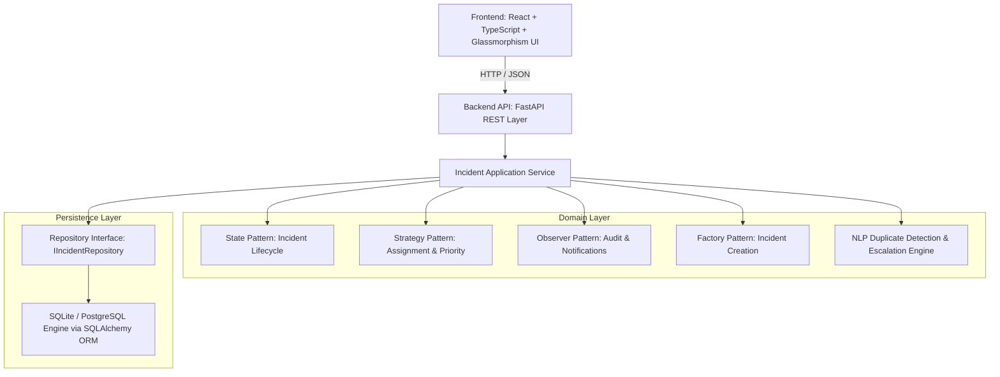
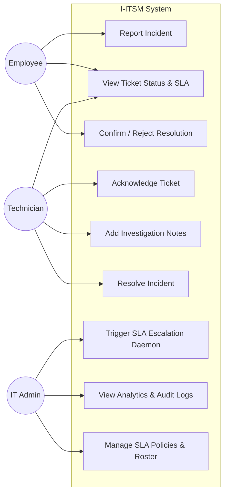
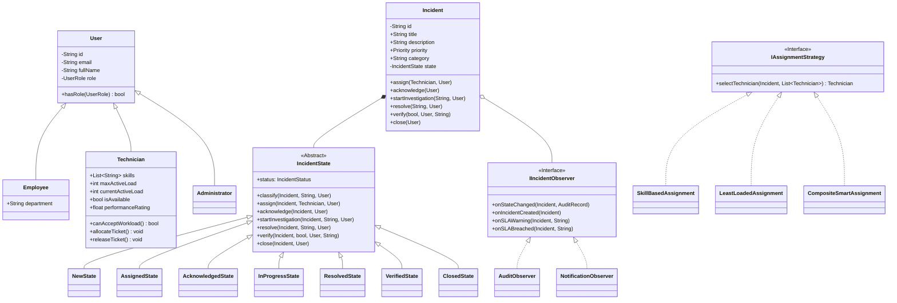
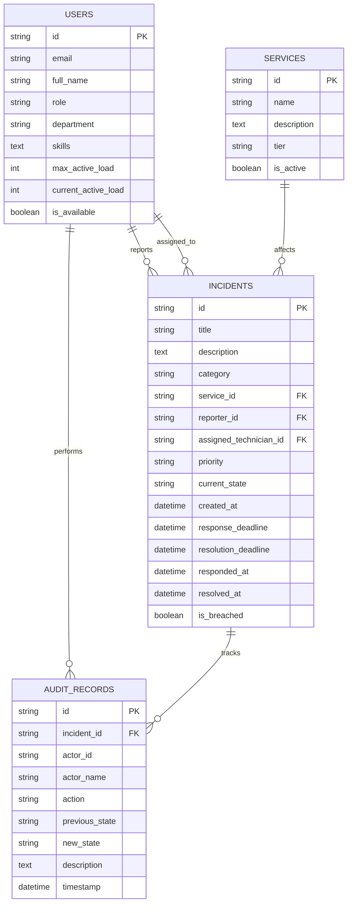

# CS F213 / MAC F212: Object-Oriented Programming
## Project Comprehensive Technical Report
### Intelligent IT Service Management & Incident Resolution System (I-ITSM)
**Semester-I, 2026–2027**  
**Group Number:** *[Insert Your Group No.]*  
**Submission Date:** November 22, 2026  
**Repository:** https://github.com/daksh-tamoli/OOPS_PROJECT_26  

---

## 1. Problem Analysis

### 1.1 Problem Statement
Modern enterprise infrastructures encompass hundreds of interconnected cloud instances, databases, authentication identity providers, payment processors, and storage networks. When failures emerge (e.g. database deadlocks, network timeouts, payment gateway disruptions), organizations suffer revenue loss, SLA penalties, and customer churn. 

Managing incidents manually introduces critical vulnerabilities:
- Delayed technician response and prolonged resolution times.
- Arbitrary, subjective incident prioritization causing neglected high-impact failures.
- Inefficient technician workload distribution and skill mismatches.
- Duplicate reporting for single root-cause infrastructure faults.
- Lack of immutable audit tracking for compliance and post-incident postmortems.

### 1.2 Stakeholders
1. **Employees / Customers:** Report service disruptions, monitor ticket resolution, and confirm or reject resolution quality.
2. **Technicians / Support Engineers:** Triage assigned incidents according to specialization, document diagnostic findings, and submit verified resolutions.
3. **IT Administrators / Managers:** Configure SLA policies, supervise technician rosters, trigger automated escalations, and monitor organizational health.

### 1.3 Proposed Solution: I-ITSM
An object-oriented enterprise system engineered around formal design patterns:
- **Encapsulated State Machine (State Pattern)** preventing invalid ticket progression.
- **Interchangeable Routing & Prioritization (Strategy Pattern)** tailoring assignment based on skills, load, and service criticality.
- **Event-Driven Auditing (Observer Pattern)** guaranteeing tamper-evident event trails.
- **Intelligent NLP Modules** detecting duplicate ticket submissions and predicting SLA breaches.

---

## 2. Requirements Specification

### 2.1 Functional Requirements
- **FR-01 (User Management):** Role-based access control supporting `Employee`, `Technician`, and `Administrator`.
- **FR-02 (Incident Reporting):** Creation of incident tickets with affected service, impact, urgency, and description.
- **FR-03 (State Machine Lifecycle):** Strict sequence of transitions: `NEW` $\to$ `CLASSIFIED` $\to$ `ASSIGNED` $\to$ `ACKNOWLEDGED` $\to$ `IN_PROGRESS` $\to$ `RESOLVED` $\to$ `VERIFIED` $\to$ `CLOSED`.
- **FR-04 (SLA Engine):** Automatic response and resolution deadline calculation per priority level with breach detection.
- **FR-05 (Intelligent Duplicate Detection):** NLP text similarity and token overlap to flag related ongoing disruptions.
- **FR-06 (Automated Hierarchical Escalation):** Proactive elevation of unacknowledged tickets from Technician to Team Lead to IT Manager.
- **FR-07 (Audit History):** Immutable append-only audit trail logging every action, actor, timestamp, and state delta.

### 2.2 Non-Functional Requirements
- **NFR-01 (Extensibility):** Adding new categories, SLA tiers, or assignment algorithms must not modify existing core domain logic (Open/Closed Principle).
- **NFR-02 (Robustness):** Robust custom domain exception hierarchy rejecting invalid operations without crashing.
- **NFR-03 (Maintainability):** Clear separation between Presentation (React), Application (FastAPI), Domain (OOP entities), and Persistence (SQLAlchemy Repositories).

---

## 3. Technology Selection Report (Faculty 9-Question Evaluation)

| # | Faculty Evaluation Question | Architectural Justification |
| :--- | :--- | :--- |
| **1** | **Why this programming language?** | Python 3.13 was chosen for its mature, first-class OOP support (Abstract Base Classes `abc`, protocols, typed hierarchies) combined with native scientific NLP capabilities (`scikit-learn`, `numpy`) required for intelligent duplicate detection. |
| **2** | **Why this frontend technology?** | React 19 + TypeScript + Vite. TypeScript enforces type safety matching the backend domain models, while Vite delivers sub-second Hot Module Replacement (HMR). Glassmorphic custom CSS provides an executive-grade user experience. |
| **3** | **Why this backend technology?** | FastAPI. It provides high-performance asynchronous request handling, automatic OpenAPI/Swagger documentation, and clean dependency injection that mirrors the Repository Pattern. |
| **4** | **Why this database?** | SQLite (via SQLAlchemy 2.0 ORM). Provides zero-configuration ACID compliance, relational integrity across foreign keys, and complete data persistence between server lifespans, readily scalable to PostgreSQL in enterprise deployment. |
| **5** | **Why this architecture?** | Layered Clean Architecture (Domain $\to$ Application $\to$ Infrastructure $\to$ Presentation). Domain models have zero dependencies on external frameworks, guaranteeing high testability. |
| **6** | **What alternatives were considered?** | Considered Java Spring Boot and Django. Spring Boot was rejected due to heavy XML/annotation boilerplate; Django was rejected due to its tightly coupled Active-Record ORM which violates pure Domain-Driven Design (DDD). |
| **7** | **Advantages and limitations?** | **Advantages:** Clean OOP pattern demonstration, sub-second test execution, intelligent NLP modules without external microservices. **Limitations:** Single-node SQLite concurrency limits under extreme write throughput (mitigated by switching SQLAlchemy connection string to PostgreSQL). |
| **8** | **How does the stack support OOP?** | Encapsulation via private member accessors, Inheritance in User hierarchies (`User` $\to$ `Employee`, `Technician`, `Admin`), Polymorphism across Strategy interfaces (`IAssignmentStrategy`), and pure State pattern state machines. |
| **9** | **How will the system evolve at scale?** | Decoupled Repository interfaces allow instantaneous migration to distributed PostgreSQL / CockroachDB; background SLA tasks can be moved to Celery / Redis queues; frontend is statically deployable via CDNs. |

---

## 4. System Architecture & UML Diagrams

### 4.1 System Architecture Diagram

---

### 4.2 UML Use Case Diagram

---

### 4.3 UML Class Diagram (Domain Model & Patterns)

---

### 4.4 Entity-Relationship (ER) Diagram

---

## 5. Testing & Validation (15 Documented Test Cases)

| Test ID | Test Category | Scenario Description | Expected Outcome | Actual Result |
| :--- | :--- | :--- | :--- | :--- |
| **TC-01** | State Pattern | Direct transition from `NEW` $\to$ `CLOSED` | Throws `InvalidStateTransitionException`; ticket remains `NEW`. | **PASS** |
| **TC-02** | State Pattern | Full valid 8-step lifecycle progression | All transitions pass sequentially; audit records appended. | **PASS** |
| **TC-03** | Strategy Pattern | Impact=High, Urgency=High on Tier 1 Service | Evaluated to `P1 - Critical` priority via matrix strategy. | **PASS** |
| **TC-04** | Strategy Pattern | Category="Database" with `SkillBasedAssignment` | Assigned to technician possessing `database` certification. | **PASS** |
| **TC-05** | Strategy Pattern | Assignment with `LeastLoadedAssignment` | Assigned to technician with lowest active ticket count. | **PASS** |
| **TC-06** | Exception Handling | Technician at maximum active capacity | Throws `TechnicianCapacityExceededException`. | **PASS** |
| **TC-07** | SLA Engine | Creation of P1 Incident | 5 min response deadline and 30 min resolution deadline calculated. | **PASS** |
| **TC-08** | Intelligence | Incident elapsed resolution time $>70\%$ | Proactive warning flag (`is_resolution_at_risk`) returns `True`. | **PASS** |
| **TC-09** | Escalation | P1 ticket unacknowledged past response deadline | Escalation engine elevates to `IT Manager`; audit record logged. | **PASS** |
| **TC-10** | Intelligence | Two concurrent payments failing reports | Flagged as duplicate via NLP TF-IDF cosine similarity ($>0.40$). | **PASS** |
| **TC-11** | Observer Pattern | Ticket progresses across 2 state changes | Exactly 3 audit records logged chronologically (Report + 2 transitions).| **PASS** |
| **TC-12** | Authorization | Employee attempts to acknowledge/resolve | Throws `UnauthorizedActionException`. | **PASS** |
| **TC-13** | Observer Pattern | Ticket state change occurs | Dispatches simulated notification to reporter and technician. | **PASS** |
| **TC-14** | Intelligence | NLP keyword extraction on "Postgres deadlock" | Auto-infers category as `Database`. | **PASS** |
| **TC-15** | State Pattern | User rejects resolution in verification step | Status transitions from `RESOLVED` back to `IN_PROGRESS`. | **PASS** |

---

## 6. Team Role Allocation Table

| Team Member | Academic Responsibility | Concrete Module Ownership |
| :--- | :--- | :--- |
| **Student 1** | **UI/UX & Frontend Integration** | React 19 UI, Role Switching, Glassmorphic Design System, Demo Coordination |
| **Student 2** | **Backend APIs & Security** | FastAPI REST endpoints, OpenAPI Schema, CORS, Error Handlers |
| **Student 3** | **Domain Model & OOP Patterns** | State Pattern lifecycle, Strategy Pattern algorithms, Observer notifications |
| **Student 4** | **Database & SLA Engine** | SQLite persistence, Repository Pattern implementation, SLA Status Tracker |
| **Student 5** | **Intelligence & Testing** | NLP Duplicate Detection, Automatic Escalation Engine, 15 Pytest Test Cases |

---

## 7. Video Demonstration Walkthrough Plan (15–20 Mins)

1. **Introduction (0:00 – 2:30):**
   - Each member introduces themselves and describes their assigned module.
   - High-level architectural walkthrough of OOP patterns and Clean Architecture.
2. **Workflow 1: Employee Reporting & Intelligent Assignment (2:30 – 7:30):**
   - Log in as **Employee (Alice)**.
   - Report a critical Payment Gateway outage.
   - System auto-classifies as `Payment`, computes `P1 - Critical`, and assigns **Devon Vance (DB Specialist)** via Composite Smart strategy.
3. **Workflow 2: Technician Triage & SLA Tracking (7:30 – 12:30):**
   - Switch role to **Technician (Devon)**.
   - Acknowledge ticket (starts response SLA tracking).
   - Add investigation findings; resolve ticket.
   - Switch back to Alice to confirm and verify the fix.
4. **Workflow 3: Duplicate Detection & Auto-Escalation (12:30 – 17:00):**
   - Report a second similar payment failure.
   - System highlights the duplicate banner with calculated similarity score.
   - Switch to **Admin (Sarah)** and trigger the SLA daemon to demonstrate auto-escalation of overdue tickets.
5. **Conclusion & Q&A Defense (17:00 – 19:30):**
   - Review audit history and operational analytics. Final concluding remarks.
